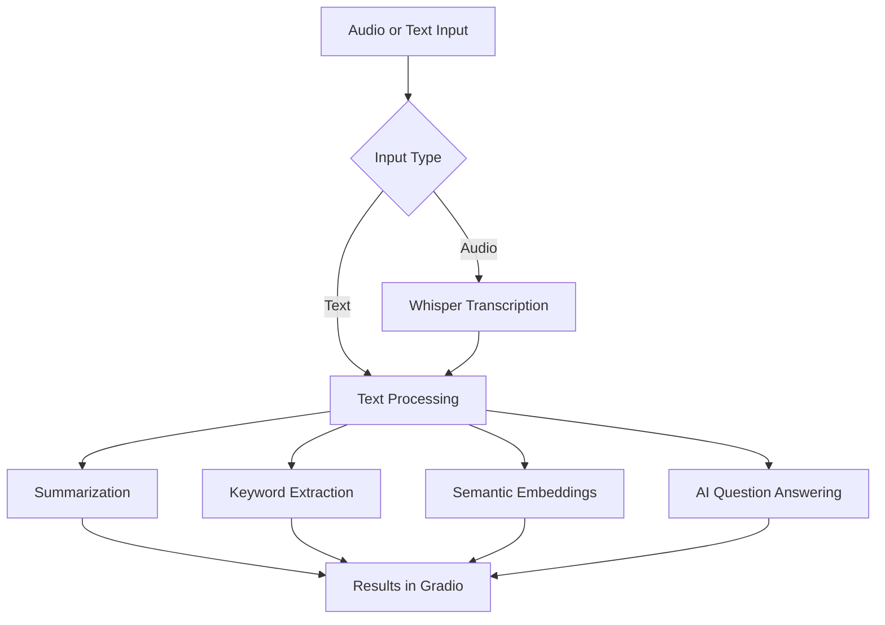

<!-- ===================== HEADER ===================== -->

<div align="center">

# 🧠 Content Intelligence Studio

### Transform audio and text into actionable insights with AI.

An AI-powered content analysis application for transcription, summarization, keyword extraction, semantic embeddings, and question answering.

<p>
  
  
  
  
</p>

<p>
  <a href="#-features">Explore Features</a> •
  <a href="#-quick-start">Quick Start</a> •
  <a href="#-demo">Demo</a> •
  <a href="#-technology-stack">Tech Stack</a>
</p>

</div>

---

## 📌 Table of Contents

- [Overview](#-overview)
- [Features](#-features)
- [Demo](#-demo)
- [Technology Stack](#-technology-stack)
- [How It Works](#-how-it-works)
- [Quick Start](#-quick-start)
- [Configuration and Requirements](#-configuration-and-requirements)
- [Project Structure](#-project-structure)
- [Troubleshooting](#-troubleshooting)
- [Roadmap](#-roadmap)
- [Contributing](#-contributing)
- [License](#-license)

---

## 🚀 Overview

**Content Intelligence Studio** brings multiple AI-powered content analysis capabilities into one Gradio application.

It is designed to help users turn audio and text into structured information that is easier to understand, explore, and use.

### Why this project?

- 🎙️ Convert audio into text.
- 📝 Generate concise summaries.
- 🏷️ Extract important keywords and topics.
- 🔎 Use semantic embeddings to represent text.
- 💬 Ask questions about content using a language model.

> **Project status:** Under development. See the Demo section for current access information.

## ✨ Features

<table>
<tr>
<td width="50%" valign="top">

### 🎙️ Audio Transcription

Transcribe audio with OpenAI Whisper.

- Speech-to-text processing
- Transcript generation
- Support depends on the underlying model and input format

</td>
<td width="50%" valign="top">

### 📝 Text Summarization

Create concise summaries from content using summarization components and a local language model.

- Condense lengthy content
- Highlight key information
- Make content easier to review

</td>
</tr>
<tr>
<td width="50%" valign="top">

### 🏷️ Keyword Extraction

Identify significant words and phrases using KeyBERT.

- Surface relevant terms
- Identify important topics
- Support content discovery

</td>
<td width="50%" valign="top">

### 🧠 Semantic Embeddings

Represent text using Sentence Transformers.

- Generate text embeddings
- Support semantic text analysis
- Provide a foundation for similarity-based workflows

</td>
</tr>
<tr>
<td width="50%" valign="top">

### 💬 AI Question Answering

Use a local Qwen language model for supported question-answering workflows.

- Ask questions about available content
- Generate model-based responses
- Run inference locally on the server

</td>
<td width="50%" valign="top">

### 🖥️ Interactive Interface

Use a Gradio-based web interface.

- Browser-based interaction
- Integrated content workflows
- Python-powered processing

</td>
</tr>
</table>

<details>
<summary><strong>🔍 See feature implementation notes</strong></summary>

The project integrates several components:

| Capability | Component |
|---|---|
| Audio transcription | OpenAI Whisper |
| Extractive summarization | TextRank summarizer |
| Keyword extraction | KeyBERT |
| Text embeddings | Sentence Transformers (`all-MiniLM-L6-v2`) |
| Local language model | Qwen2.5-1.5B-Instruct GGUF with llama.cpp |
| Web interface | Gradio |

Model availability, performance, and supported inputs depend on the application configuration and server resources.

</details>

## 🎬 Demo

### Live application

**Status: Public demo link not yet verified.**

The application is configured to run through Gradio on the server. A public-facing URL requires a reachable server, an appropriate network configuration, and a running application.

When a stable deployment is available, replace the placeholder below with its actual URL:

**[Open Content Intelligence Studio](YOUR_PUBLIC_DEMO_URL)**

> Replace `YOUR_PUBLIC_DEMO_URL` before publishing a real demo link. Do not use a local address such as `127.0.0.1` as a public demo URL.

### Screenshots and walkthrough

Screenshots and a short animated GIF can be added here after capturing the running application.

<!--
After uploading assets to your repository, uncomment and update:

<p align="center">
  
</p>

<p align="center">
  
</p>
-->

## 🛠️ Technology Stack

| Technology | Purpose |
|---|---|
| Python | Application logic |
| Gradio | Interactive web interface |
| OpenAI Whisper | Audio transcription |
| TextRank | Extractive text summarization |
| KeyBERT | Keyword extraction |
| Sentence Transformers | Text embeddings |
| Qwen2.5 Instruct GGUF | Local language-model inference |
| llama.cpp / `llama-cpp-python` | GGUF model inference |

## 🔄 How It Works



The exact processing path depends on the feature selected and the implementation in `app.py`.

## ⚡ Quick Start

### 1. Clone the repository

```bash
git clone https://github.com/nishantksyp75/content-intelligence-studio.git
cd content-intelligence-studio
```

If the repository is private, sign in to GitHub or configure an authorized Git credential before cloning.

### 2. Create a virtual environment

**Linux / macOS**

```bash
python3 -m venv .venv
source .venv/bin/activate
```

**Windows PowerShell**

```powershell
py -m venv .venv
.venv\Scripts\Activate.ps1
```

### 3. Install dependencies

```bash
python -m pip install --upgrade pip
pip install -r requirements.txt
```

Some AI dependencies may require additional system libraries or compatible Python, operating-system, and hardware configurations. Follow any installation requirements documented by the respective packages.

### 4. Start the application

```bash
python app.py
```

Open the local URL printed by Gradio in your terminal.

To exit, press `Ctrl+C` in the terminal running the application.

## ⚙️ Configuration and Requirements

### Hardware

AI workloads can be resource-intensive. Actual requirements depend on model configuration, input size, and concurrent usage.

- **CPU:** A modern CPU is recommended.
- **RAM:** More memory improves the ability to load and run multiple models.
- **Storage:** Allow space for Python dependencies, downloaded model weights, and temporary files.
- **GPU:** May improve supported workloads but is not universally required.

Small cloud instances may experience slow startup, memory pressure, or slow inference when several models are loaded together.

### Model downloads

The application uses pretrained models that may download automatically when first needed.

- Initial startup may take longer than subsequent launches.
- An internet connection may be needed to download model files.
- Hugging Face access limits may affect unauthenticated downloads.
- Keep model paths and configuration consistent with `app.py`.

### Running on a server

For a remote server, ensure that:

1. The application listens on the appropriate network interface.
2. The configured port is reachable through the server firewall and cloud security rules.
3. Access is limited appropriately.
4. A production deployment uses a secure access method, such as HTTPS behind a reverse proxy.

Do not expose development services or sensitive credentials unnecessarily.

## 📁 Project Structure

```text
content-intelligence-studio/
├── app.py
├── requirements.txt
├── README.MD
└── .gitignore
```

Additional files may exist locally or be added as the project evolves.

## 🧰 Troubleshooting

<details>
<summary><strong>Application does not start</strong></summary>

- Activate the virtual environment.
- Install dependencies from `requirements.txt`.
- Review the terminal output for the first error.
- Check that required model files can be downloaded.

</details>

<details>
<summary><strong>Gradio page is unreachable on a cloud server</strong></summary>

- Confirm that the EC2 instance is running.
- Confirm that `python app.py` is still running.
- Check the server's public IP address.
- Verify the inbound security rule for the configured application port.
- Test the app locally on the server before debugging external access.

</details>

<details>
<summary><strong>Model loading is slow or the server runs out of memory</strong></summary>

- Allow time for the initial model downloads.
- Check RAM and swap usage.
- Avoid loading unnecessary models at startup.
- Consider a larger instance if the workload exceeds available memory.
- Reduce model context or thread settings only when appropriate for the application.

</details>

<details>
<summary><strong>Hugging Face download warnings</strong></summary>

Unauthenticated downloads may have lower rate limits. If necessary, configure a Hugging Face access token through an environment variable or the supported CLI login process. Never commit tokens to the repository.

</details>

## 🗺️ Roadmap

Potential future improvements:

- [ ] Publish a stable, secure hosted demo
- [ ] Add screenshots and an animated walkthrough
- [ ] Add automated tests
- [ ] Improve progress and error reporting
- [ ] Add configurable model settings
- [ ] Add deployment documentation
- [ ] Improve performance and resource management

## 🤝 Contributing

Contributions, bug reports, and feature suggestions are welcome.

1. Fork the repository.
2. Create a feature branch.
3. Make and test your changes.
4. Open a pull request with a clear description.

For bugs, include reproducible steps and relevant error messages. Remove secrets, access tokens, and private data before sharing logs.

## 📄 License

Check the repository for a `LICENSE` file before redistributing or reusing this project. If no license is present, permissions should not be assumed.

---

<div align="center">

**Built with Python and open-source AI tools.**

[⬆ Back to Top](#-content-intelligence-studio)

</div>
